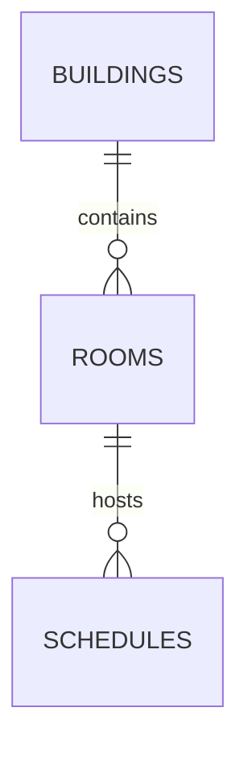

# Database design

`buildings` has a unique code and required name. `rooms` references buildings with `ON DELETE NO ACTION`, has positive capacity, an allowed status (`AVAILABLE`, `MAINTENANCE`, `INACTIVE`), and a unique `(building_id, code)`. `schedules` references rooms with `ON DELETE NO ACTION`, validates weekday 1–7, date/time ordering, and non-negative optional student count.

Indexes support case-insensitive building lookup, room building/capacity/type/status filters, and schedule room/class overlap and date-range queries. Migrations are in `src/main/resources/db/migration`; Hibernate runs with `ddl-auto=validate`.
